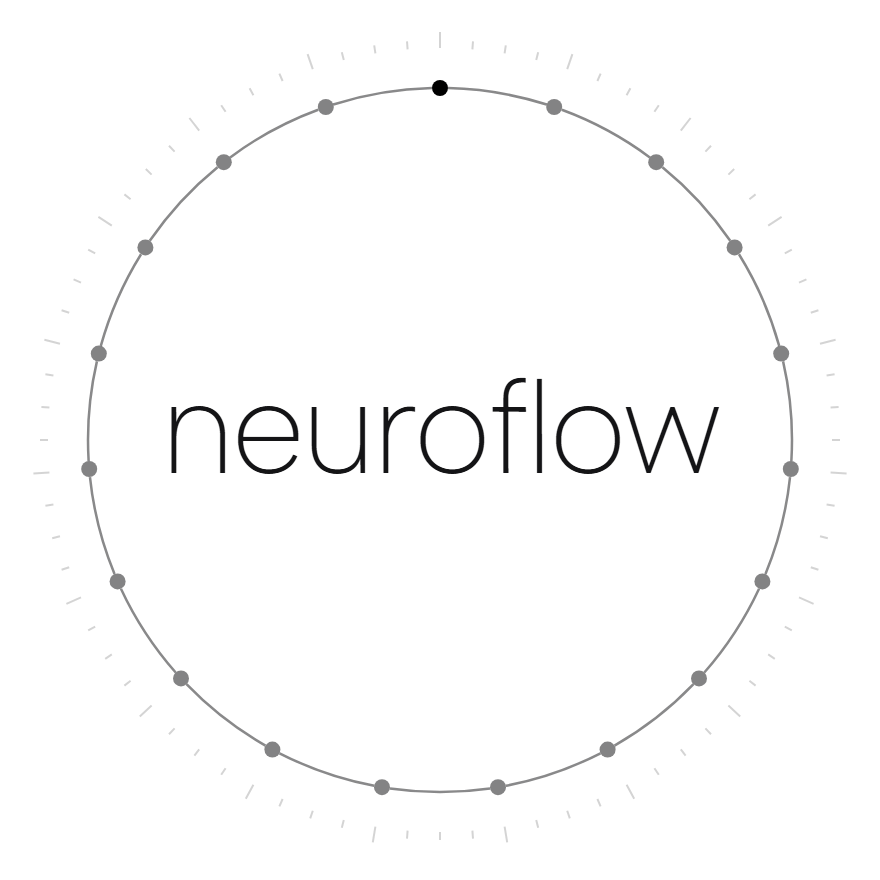
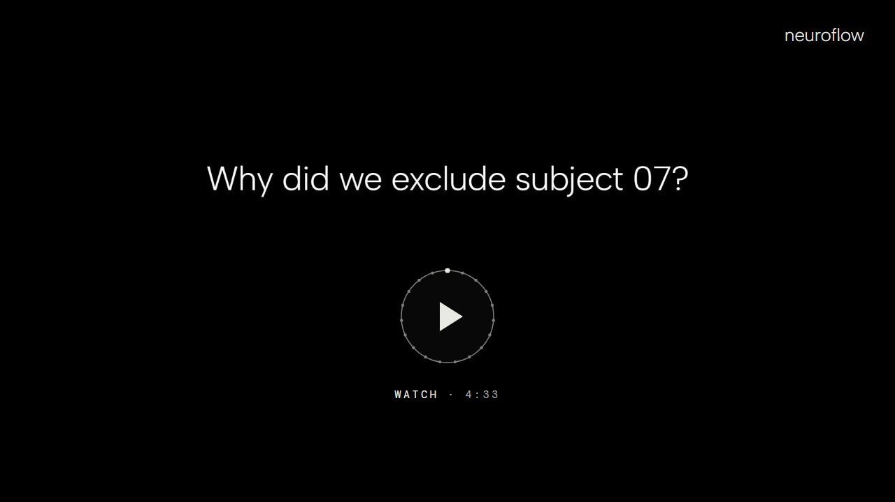

<div align="center">
  <a href="https://stanislavjiricek.github.io/neuroflow/"><picture><source media="(prefers-color-scheme: dark)" srcset="docs/assets/brand/neuroflow-lockup-dark.png"></picture></a>
  <p><strong>Your team's shared memory. Inside Claude Code.</strong><br>
  A complete research system for neuroscience teams.</p>
  <a href="https://stanislavjiricek.github.io/neuroflow/overview/#intro-video"></a>
  <p><sub>The 4:33 intro: why neuroflow, how to install it, and how to set up your flowie, your hive and your first project. In English with captions, synthetic voice; it plays on the website.</sub></p>
  <p>
    <a href="https://stanislavjiricek.github.io/neuroflow/">Website</a> ·
    <a href="https://stanislavjiricek.github.io/neuroflow/overview/">Documentation</a> ·
    <a href="https://stanislavjiricek.github.io/neuroflow/changelog/">Changelog</a> ·
    <a href="https://stanislavjiricek.github.io/neuroflow/installation/">Install</a>
  </p>
</div>

<a id="whats-new"></a>
## What's new in 0.2.25

- **Safer project registry and flowie sync** — a final review of 0.2.24 found three problems, now fixed: folding two cards of one project never puts a folder from one of your machines on the team's card (it goes to `~/.neuroflow/local-projects.json`); [`/sentinel`](commands/sentinel.md) shows the registry findings in the session and never writes your private flowie's project names into the committed `sentinel.md`; and [`/flowie --sync`](commands/flowie.md) resolves files an `--autostash` pull could not give back, with you, so no conflict markers are ever committed — the auto-sync hook and the mod skip and log such a state instead of pushing it
- **Smaller fixes** — a hive member's state moves only their own values out of an old tracked `sync.json`; `repos` written as a single string counts as one repository; a task may name a project whose card is on another level; `/phase --sync` records the current phase on your cards; the board cache uses your own ssh setup when you have one ([#251](https://github.com/stanislavjiricek/neuroflow/issues/251)–[#256](https://github.com/stanislavjiricek/neuroflow/issues/256) follow-ups)

Every earlier release is in the [changelog](https://stanislavjiricek.github.io/neuroflow/changelog/).

## Installation

In Claude Code 2.1.275 or later:

```
/plugin install neuroflow --marketplace stanislavjiricek/neuroflow
```

Then run `/neuroflow:neuroflow` in your project folder. After each update, run `/neuroflow:migrate` once in every project.

Installing adds:

- three MCP servers that start with `npx`: literature search, library documentation and step-by-step reasoning (none needs credentials);
- shell hooks that run for everyone who installs the plugin: ruff formats the Python files Claude writes, a file Claude writes into your private flowie repository is committed and pushed, Sci-Hub calls are blocked, and PsychoPy paradigms get a static audit;
- the neuroflow mod, which shows the project inside Claude Code. By default it only observes: views and warnings, no writes of its own, no blocking.

Other ways to install, the requirements and local development: [Installation](https://stanislavjiricek.github.io/neuroflow/installation/).

## Commands

Run `/neuroflow:<command>` in any project folder. Start with `/neuroflow:neuroflow`.

### Entry point

| Command | What it does |
|---|---|
| [`/neuroflow`](commands/neuroflow.md) | Main entry point — if `.neuroflow/` exists, shows current phase and status; if not, interviews the user and creates the project memory structure |
| [`/setup`](commands/setup.md) | Integration wizard — Google Workspace CLI, optional Miro (you add it with `claude mcp add`, so no token ever enters the chat) and an Anthropic-compatible LLM gateway; stores non-secret settings in `~/.neuroflow/integrations.json` (or a per-project override) |
| [`/migrate`](commands/migrate.md) | After a plugin update, bring your project, your flowie and the team hive up to the current format — shows the plan, writes only after you agree, pushes to a hive only after your yes |

### Research pipeline

| Command | What it does |
|---|---|
| [`/ideation`](commands/ideation.md) | Brainstorm a research question, explore literature with the inline literature search (open-access only), formalize an idea, keep a standing-query watch list, or produce a project proposal |
| [`/preregistration`](commands/preregistration.md) | Pre-register study design and analysis plan on OSF or AsPredicted; review for completeness; **freeze** the plan (hashes, banner, append-only deviations); log deviations; link registered reports |
| [`/ethics`](commands/ethics.md) | Ethics/IRB workflow — protocol and amendments, versioned consent, approval status with expiry, whether the AI model may read participant data, and participant-erasure requests |
| [`/grant-proposal`](commands/grant-proposal.md) | Write a grant application — specific aims, significance, innovation, approach, budget, timeline, data management plan, and an AI-use statement |
| [`/finance`](commands/finance.md) | Manage the project budget, log expenses in a fixed ledger, produce financial reports, and check grant compliance |
| [`/experiment`](commands/experiment.md) | Paradigm design (PsychoPy) with a static audit, recording setup, counterbalancing, instrument and LSL configuration |
| [`/tool-build`](commands/tool-build.md) | Build a lab tool or software pipeline — real-time systems, acquisition, BCI, paradigm code |
| [`/tool-validate`](commands/tool-validate.md) | Verify a tool or paradigm — marker-to-photodiode timing, XDF and LSL stream checks |
| [`/data`](commands/data.md) | Data intake — locate data, check the ethics gate, validate BIDS structure, keep raw data read-only |
| [`/data-preprocess`](commands/data-preprocess.md) | Run a preprocessing pipeline — filtering, ICA, epoching, artifact rejection, a QC matrix |
| [`/data-analyze`](commands/data-analyze.md) | Run an analysis pipeline — ERPs, time-frequency, connectivity, decoding, GLM — with provenance records, an optional multiverse, and clean-room reruns |
| [`/paper`](commands/paper.md) | Unified manuscript writing and review — draft section by section in a write→critique loop; `--submit` checks citations, statistics and figures and drafts the AI-use statement; `--revise`, `--coauthor`, `--xray`, `--auto` |
| [`/review`](commands/review.md) | Peer review a colleague's paper — asks about the journal's AI policy first, keeps the manuscript confidential, scans for hidden instructions |
| [`/notes`](commands/notes.md) | Live note-taking — capture freeform input verbatim, then reformat it; `--idea` stashes an idea in one step |
| [`/write-report`](commands/write-report.md) | Generate a structured report from `.neuroflow/` contents for any phase or the whole project |

### Brain simulation

| Command | What it does |
|---|---|
| [`/brain-build`](commands/brain-build.md) | Assemble a computational brain model — neuron models, network topology, connectivity, simulation framework setup, smoke tests |
| [`/brain-optimize`](commands/brain-optimize.md) | Run a parameter search behind a smoke gate, or fit the model to experimental data |
| [`/brain-run`](commands/brain-run.md) | Run the model as a simulation — long runs registered in `runs.md`, SLURM/PBS job templates, never heavy compute on a login node |

### Utility

| Command | What it does |
|---|---|
| [`/dashboard`](commands/dashboard.md) | The project at a glance — phase map, deadlines, integrity state, task board counts, the running autoresearch loop (a live pane with the neuroflow mod) |
| [`/doctor`](commands/doctor.md) | Health check of the setup around a project — tools, backups, storage location, contracts, and whether the neuroflow mod is live |
| [`/git`](commands/git.md) | Context-aware git utility — smart push/pull, commit messages, branches, PRs with shorthand aliases whose scope is final; never commits local-only files (sessions, reviews, credentials) |
| [`/pipeline`](commands/pipeline.md) | Define and run a multi-step research pipeline — one step per invocation from a saved plan; interactive by default, or `--executor` for no questions |
| [`/interview`](commands/interview.md) | Interview preparation from either side — tailored questions, practice Q&A, readiness evaluation; candidate notes stay private |
| [`/phase`](commands/phase.md) | Show the phase map and switch phase (a picker you drive with the arrow keys or a click when the neuroflow mod is on) |
| [`/tasks`](commands/tasks.md) | Single entry point for the 3-tier Kanban task board (project / flowie / hive) — view, add, move, complete, archive |
| [`/sentinel`](commands/sentinel.md) | Full audit of `.neuroflow/` — deterministic checks (`nf_check.py`) first, then drift, broken references, preregistration vs progress |
| [`/slideshow`](commands/slideshow.md) | Build a presentation from selected areas of the project — pick phases, figures, and key findings, then get a structured slide deck ready to export |
| [`/poster`](commands/poster.md) | Generate a LaTeX conference poster from project memory — compiled and rendered between critic rounds |
| [`/quiz`](commands/quiz.md) | Neuroscience quiz — flashcards, pub quiz, or rapid-fire throw questions; covers any subfield or general neuroscience |
| [`/fails`](commands/fails.md) | Log dissatisfaction — record core behavior, science quality, or UX issues; opens a GitHub issue only after you confirm |
| [`/output`](commands/output.md) | Export or archive the project with a real exporter (local-only and sensitive files excluded), header de-identification and git-history audits, and a `--handoff` dossier |
| [`/idk`](commands/idk.md) | Personal support companion — decompress, break down overwhelming tasks, or just chat; nothing is logged |
| [`/search`](commands/search.md) | Lightweight scoped search — use `memory:` to search `.neuroflow/` or `project:` to search the codebase; uses `flow.md` as a fast index |
| [`/wiki`](commands/wiki.md) | Project-level shared knowledge base — LLM-maintained wiki at `.neuroflow/wiki/`, git-tracked and shared with collaborators; ingest, query, lint, and add workflows |
| [`/autoresearch`](commands/autoresearch.md) | Open-ended improvement loop for any research artifact — one managing agent makes one focused change per iteration and keeps or reverts it, with a per-loop wiki as memory; an integrity gate for analysis code (confirmatory or exploratory); never stops on its own judgement, always stops at the caps you set, when you stop it, or after repeated errors; bookkeeping by the tested `ar.py` script |
| [`/flowie`](commands/flowie.md) | Personal research OS — link a private GitHub repository as identity profile + Kanban task board + project registry with phase tracking; synced by path with pull-before-push |
| [`/hive`](commands/hive.md) | Team knowledge layer — connect your project to a shared GitHub org repo to sync team research directions, dataset errata, and a review checklist; every push confirmed |
| [`/meeting`](commands/meeting.md) | First-class meetings — recurring templates, agendas with task context, calendar invites after you confirm the recipients, live notes, and tasks from action items |

## Skills

Claude loads a skill on its own when it is relevant, or when you name it.

<details>
<summary>Show all skills</summary>

| Skill | What it does |
|---|---|
| [`neuroflow:neuroflow-core`](skills/neuroflow-core/SKILL.md) | Core rules and lifecycle for all commands and agents — `.neuroflow/` spec and contracts (config frontmatter, integrity status files, JSONL reasoning logs, sharing tiers, command lifecycle keys, rule markers), and behavioral modes (`teacher`, `executor`, `critic`) |
| [`neuroflow:review-neuro`](skills/review-neuro/SKILL.md) | Rigorous pre-submission peer review of a neuroscience manuscript, with a hidden-instruction scan |
| [`neuroflow:worker-critic`](skills/worker-critic/SKILL.md) | Worker-critic agentic loop protocol — orchestrator coordinates a worker agent and a critic agent across up to 3 revision cycles, resuming the same agents for revisions |
| [`neuroflow:autoresearch-protocol`](skills/autoresearch-protocol/SKILL.md) | Improvement-loop protocol — the single-agent loop, per-loop wiki, program.md config with caps, the integrity gate and multiverse ledger, `ar.py` bookkeeping, Q&A channel, and dashboard |
| [`neuroflow:neuroflow-develop`](skills/neuroflow-develop/SKILL.md) | Guide for developing and maintaining the neuroflow plugin, including the mod |
| [`neuroflow:skill-creator`](skills/skill-creator/SKILL.md) | Guide for creating new neuroflow skills |
| [`neuroflow:setup-guide`](skills/setup-guide/SKILL.md) | Configure integrations — Google Workspace, optional Miro, and Anthropic-compatible LLM gateways — without ever asking for a secret in chat |
| [`neuroflow:phase-git`](skills/phase-git/SKILL.md) | Phase guidance for /git — shorthand rules, alias scope, local-only files, smart push/pull, commit messages, branches, PRs |
| [`neuroflow:phase-ideation`](skills/phase-ideation/SKILL.md) | Phase guidance for /ideation — search protocol against the bundled literature server, open-access downloads, standing queries |
| [`neuroflow:phase-preregistration`](skills/phase-preregistration/SKILL.md) | Phase guidance for /preregistration — registry templates, completeness checks, freezing with hashes, deviation logging |
| [`neuroflow:phase-grant-proposal`](skills/phase-grant-proposal/SKILL.md) | Phase guidance for /grant-proposal |
| [`neuroflow:phase-finance`](skills/phase-finance/SKILL.md) | Phase guidance for /finance — budget planning, a fixed expense ledger (`ledger.py`), compliance checks |
| [`neuroflow:phase-experiment`](skills/phase-experiment/SKILL.md) | Phase guidance for /experiment — PsychoPy audit, counterbalancing ledger, preflight template |
| [`neuroflow:phase-tool-build`](skills/phase-tool-build/SKILL.md) | Phase guidance for /tool-build |
| [`neuroflow:phase-tool-validate`](skills/phase-tool-validate/SKILL.md) | Phase guidance for /tool-validate — timing, XDF and LSL checks |
| [`neuroflow:bids`](skills/bids/SKILL.md) | Brain Imaging Data Structure — folder hierarchy, entity ordering, required files per modality (checked against BIDS 1.11.2), sidecars, derivatives, bids-validator digests, pybids, MNE-BIDS, DataLad |
| [`neuroflow:phase-data`](skills/phase-data/SKILL.md) | Phase guidance for /data — ethics gate, read-only raw data, erasure sweep |
| [`neuroflow:phase-data-preprocess`](skills/phase-data-preprocess/SKILL.md) | Phase guidance for /data-preprocess — QC matrix, label-coded blinding, ICA decision records |
| [`neuroflow:phase-data-analyze`](skills/phase-data-analyze/SKILL.md) | Phase guidance for /data-analyze — provenance helper, notebooks, multiverse, clean-room reproduction |
| [`neuroflow:phase-paper`](skills/phase-paper/SKILL.md) | Phase guidance for /paper — write→critique loop, citation/statistics/revision checks, AI-use disclosure, living paper skeleton |
| [`neuroflow:phase-review`](skills/phase-review/SKILL.md) | Phase guidance for /review — referee orientation, confidentiality, delegation to review-neuro, output to .neuroflow/review/ |
| [`neuroflow:humanizer`](skills/humanizer/SKILL.md) | Style editing on request — word blacklist, rhythm, register; never a way to hide AI use, which is always disclosed |
| [`neuroflow:phase-notes`](skills/phase-notes/SKILL.md) | Phase guidance for /notes — live capture format, idea inbox |
| [`neuroflow:phase-write-report`](skills/phase-write-report/SKILL.md) | Phase guidance for /write-report |
| [`neuroflow:phase-quiz`](skills/phase-quiz/SKILL.md) | Phase guidance for /quiz — mode behaviour, question quality standards, mode-specific workflow |
| [`neuroflow:phase-fails`](skills/phase-fails/SKILL.md) | Phase guidance for /fails — categorisation, confirmed GitHub reporting, dissatisfaction capture rules |
| [`neuroflow:phase-output`](skills/phase-output/SKILL.md) | Phase guidance for /output — exporter, header and history audits, PII scan, handoff dossier |
| [`neuroflow:phase-brain-build`](skills/phase-brain-build/SKILL.md) | Phase guidance for /brain-build — neuron models, connectivity, simulation framework, smoke tests |
| [`neuroflow:phase-brain-optimize`](skills/phase-brain-optimize/SKILL.md) | Phase guidance for /brain-optimize — parameter sweeps with a smoke gate, data fitting, optimisation algorithms |
| [`neuroflow:phase-brain-run`](skills/phase-brain-run/SKILL.md) | Phase guidance for /brain-run — long runs, HPC job templates, run registry, output sanity checks |
| [`neuroflow:phase-search`](skills/phase-search/SKILL.md) | Phase guidance for /search — tag-based scoping, flow.md-first indexing strategy, compact summary format |
| [`neuroflow:phase-pipeline`](skills/phase-pipeline/SKILL.md) | Phase guidance for /pipeline — one step per invocation, interactive vs executor mode, pipeline plan format, resume logic |
| [`neuroflow:phase-flowie`](skills/phase-flowie/SKILL.md) | Phase guidance for /flowie — profile read and apply rules, write rules for `~/.neuroflow/flowie/`, one git pattern for sync |
| [`neuroflow:phase-meeting`](skills/phase-meeting/SKILL.md) | Phase guidance for /meeting — meeting file format, recurring templates, attendee resolution, calendar integration, and `meeting_close.py` |
| [`neuroflow:wiki-protocol`](skills/wiki-protocol/SKILL.md) | Knowledge base protocol — LLM-maintained wiki at three levels (personal/flowie, project, team/hive); ingest/query/lint/add workflows, branch-safe sync |
| [`neuroflow:phase-poster`](skills/phase-poster/SKILL.md) | LaTeX poster generation — five templates (A0/A1/A2, portrait/landscape, US size), QR code integration, compile-and-preview between critic rounds |
| [`neuroflow:notebooklm`](skills/notebooklm/SKILL.md) | Google NotebookLM — notebooks, sources (each upload confirmed), artifacts (podcast, video, slides, infographic, report, quiz, flashcards, mind map) and downloads |
| [`neuroflow:phase-hive`](skills/phase-hive/SKILL.md) | Team-level knowledge layer — a shared GitHub org repo for team directions, cross-project findings, dataset errata and recommended methods; all sharing is explicit |
| [`neuroflow:phase-slideshow`](skills/phase-slideshow/SKILL.md) | Phase guidance for /slideshow — audience calibration, slide count heuristics, Markdown/reveal.js and structured outline output formats |
| [`neuroflow:pupil-labs-neon-realtime`](skills/pupil-labs-neon-realtime/SKILL.md) | Connect to Pupil Labs Neon eye-tracking glasses and collect real-time data streams (video, gaze, IMU, events) via the Real-time API |

</details>

## Agents

Agents are autonomous subprocesses launched by commands when deeper, focused work is needed.

| Agent | What it does |
|---|---|
| [`scholar`](agents/scholar.md) | Searches PubMed and bioRxiv with CrossRef / Semantic Scholar / arXiv fallbacks through the bundled server, downloads open-access copies only (never Sci-Hub), labels each DOI with the check actually done, and ends with a report line the mod can check against the disk |
| [`sentinel`](agents/sentinel.md) | Project coherence guard — runs `nf_check.py` first, then audits `.neuroflow/` for drift, broken references, preregistration deviations, and personal data |
| [`sentinel-dev`](agents/sentinel-dev.md) | Plugin development coherence guard — runs the same checks CI runs (`validate_pr.py`), then the judgement checks |
| [`paper-writer`](agents/paper-writer.md) | Unified paper phase writer — drafts sections from upstream memory, cites only from the project library, returns open questions instead of waiting |
| [`paper-critic`](agents/paper-critic.md) | Unified paper phase critic — applies full eight-area review-neuro methodology to every draft; returns [STATUS: APPROVED] or [STATUS: REJECTED] with specific actionable feedback |
| [`poster-critic`](agents/poster-critic.md) | Conference poster critic — judges the rendered poster and its LaTeX source across content, layout, communication, QR code and LaTeX correctness; operates inside the /poster worker-critic loop |
| [`flowie`](agents/flowie.md) | Personal identity agent — reads the user's flowie profile, surfaces active tasks for the current project at session start, and applies research stances, writing style, and methodological preferences; never exposes profile data in external-facing outputs |
| [`literature-review`](agents/literature-review.md) | Literature review specialist — runs 12 sequential analytical lenses on a set of downloaded papers, checking each lens with a rubric critic pass and saving resumable checkpoints |
| [`autoresearch`](agents/autoresearch.md) | Autoresearch loop agent — the single managing agent for the improvement loop; one focused change per iteration, judged by itself, kept or reverted, with a per-loop wiki as memory; stops at its caps |

## Learn more

- [Overview](https://stanislavjiricek.github.io/neuroflow/overview/) — why neuroflow, the nineteen phases and the common paths through them
- [Three levels](https://stanislavjiricek.github.io/neuroflow/concepts/memory/) and [project memory](https://stanislavjiricek.github.io/neuroflow/concepts/project-memory/) — you, the project and the team, and what `.neuroflow/` holds
- [The neuroflow mod](https://stanislavjiricek.github.io/neuroflow/concepts/mods/) — the dashboard, task boards and band inside Claude Code, and guards for the rules the skills state
- [Hooks](https://stanislavjiricek.github.io/neuroflow/concepts/hooks/) — what the shell hooks do on each tool call, and what they skip
- [Integrations](https://stanislavjiricek.github.io/neuroflow/integrations/) — the bundled MCP servers, Miro, the Google Workspace CLI, LLM gateways and Zotero
- [Upgrading](https://stanislavjiricek.github.io/neuroflow/upgrading/) · [Troubleshooting](https://stanislavjiricek.github.io/neuroflow/troubleshooting/)

## Contributing

Contributions from neuroscience labs are welcome: a skill for a modality or a method, a command for a workflow, an agent for a focused task. Open an issue to talk an idea through before you build it, and start from the development guide, [`neuroflow:neuroflow-develop`](skills/neuroflow-develop/SKILL.md). Before a pull request, run what CI runs:

```bash
python scripts/automation/validate_pr.py
python -m unittest discover -s tests -p "test_*.py" -v
```

## License

MIT © Stanislav Jiricek — see [LICENSE](LICENSE).
